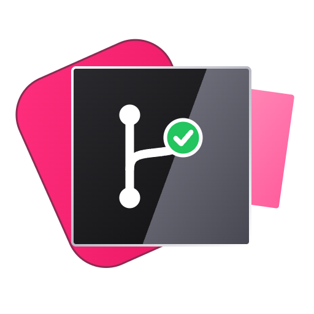

<div align="center">



# youtrack-task

**Work JetBrains YouTrack issues without leaving your repo.**
Capture, pick up, branch, plan, open the PR, and walk the state ladder — all from inside Claude Code.

<code>📥 capture</code> &nbsp;→&nbsp; <code>🌿 branch + plan</code> &nbsp;→&nbsp; <code>🚀 PR</code> &nbsp;→&nbsp; <code>✅ done</code>


</div>

---

## ✨ What it does

A Claude Code plugin that works [JetBrains YouTrack](https://www.jetbrains.com/youtrack/)
issues from inside any project repo. No PhpStorm YouTrack plugin needed: it talks to
YouTrack's own remote MCP server.

|    | Command | What it does |
|:--:|---------|--------------|
| 📝 | **`/youtrack-task new "<free text>"`** | Turns your text into a titled, structured issue. |
| 🌿 | **`/youtrack-task <ID>`** | Picks up an issue: branch, state → *In Progress*, plan written back as a comment. |
| 🚀 | **`/youtrack-task pr`** · `testing` · `done` | Checks the independent review, opens the PR and links it, then walks the state ladder. |
| 🌲 | **`/youtrack-task worktree …`** | Runs several tasks at once, each in its own git worktree. |
| 🤖 | **`/youtrack-task all`** | Works through many issues in parallel with an independent reviewer per result. |

---

## ⚡ Quick start

### 1. Check the requirements

- Claude Code with plugin support
- YouTrack **2025.3+** (Cloud or Server) with the remote MCP server at `https://<your-host>/mcp`
- `git` on your `PATH`
- `jq` on your `PATH` — needed for the hook protections; the skill itself works without it
- *(optional)* the [`gh` CLI](https://cli.github.com/) for `pr`
- *(optional)* the [`superpowers`](https://github.com/obra/superpowers) plugin for planning and implementation

> [!TIP]
> Behind a reverse proxy or SSO (Authelia, Authentik, oauth2-proxy…)? Allow the
> `/mcp` path through with bearer-token auth.

### 2. Create an API token

YouTrack → your avatar → **Profile** → **Account Security** → **New token**.
Scope: **YouTrack**. Copy the `perm:...` value.

### 3. Export two environment variables

Put them in your shell startup (`~/.zshrc`, `~/.bashrc`), then open a new shell and start
Claude Code from there:

```sh
export YOUTRACK_MCP_URL="https://youtrack.example.com/mcp"
export YOUTRACK_TOKEN="perm:xxxxxxxxxxxxxxxxxxxx"
```

### 4. Install the plugin

```text
/plugin marketplace add JtheGunner/youtrack-task
/plugin install youtrack-task@youtrack-task
```

Restart Claude Code. `/mcp` should now list the `youtrack` tools.

### 5. Try it

```text
/youtrack-task                 # list your Open / In Progress issues and pick one
/youtrack-task INFRA-42        # go straight to an issue
```

> [!NOTE]
> Nothing instance-specific is stored in this repo. The bundled `.mcp.json` only
> references `${YOUTRACK_MCP_URL}` and `${YOUTRACK_TOKEN}`.

---

## 🧭 How a task flows

```text
 /youtrack-task new …     create the issue (optional)
          │
          ▼
 /youtrack-task ADMIN-6   branch · In Progress · plan · (--implement) code + review
          │
          ▼
 /youtrack-task pr        review check · push · PR · link on issue · → Testing
          │
      … PR review + merge …
          ▼
 /youtrack-task done      → Done
```

A worked walk-through with the state changes and comments of each step:
[`examples/full-lifecycle.md`](skills/youtrack-task/examples/full-lifecycle.md).

On pickup the plugin:

1. 📥 **Fetches** the issue and its comments
2. 🌿 **Creates** the branch `‹prefix›/‹ID›-‹slug›` (in a worktree if configured)
3. 📌 **Moves** the issue to *In Progress* and comments
4. 📝 **Plans** the work and, once you approve, posts the plan as a comment
5. 🛠️ **Implements** it only when you pass `--implement`, then runs the review gate

> [!IMPORTANT]
> Nothing is pushed until you run `pr`, and it asks first. Branch names, commits and
> PR text are always English; YouTrack comments follow the issue's language.

---

## 🧰 Command cheat sheet

```text
/youtrack-task ‹ID› [--implement]        # pick up (plan only without --implement)
/youtrack-task new "<free text>"         # capture an issue
/youtrack-task comment [‹ID›] <text>     # comment on an issue
/youtrack-task log [‹ID›] 1h30m <what>   # log time
/youtrack-task pr                        # push + PR + link + Testing
/youtrack-task link <pr-url>             # attach an already-open PR
/youtrack-task testing | done            # move the issue forward
/youtrack-task worktree list|prune|take <ID>|remove <ID>
/youtrack-task all [ID ...] [--max N] [--dry-run] [--auto-merge]
```

- **State ladder:** `Open → In Progress → Testing → Done`, forward-only.
- **Issue ID:** `comment`, `log`, `pr`, `link`, `testing` and `done` read it from your
  branch name. Pass an ID to override.
- **Common flags:** `--no-move`, `--no-writeback`, `--base ‹branch›`, `--worktree`,
  `--no-review`, `--no-confirm-branch`, `--no-confirm-pr`. All of them are in the
  [flag table](docs/usage.md#flags).

---

## 📚 Documentation

| | Page | Covers |
|:-:|------|--------|
| 🚀 | [Usage](docs/usage.md) | Pickup steps, flags, creating issues, parallel worktrees, sub-commands |
| 🤖 | [Batch (`all`)](docs/batch.md) | Triage, workers, review loop, `--auto-merge`, guard hook |
| ⚙️ | [Configuration](docs/configuration.md) | Config keys with defaults, what lives where, MCP tools used |
| 🩺 | [Troubleshooting](docs/troubleshooting.md) | Symptoms and fixes, grouped by topic |

---

## 🧩 Use it in other agents

`skills/youtrack-task/` is a self-contained `SKILL.md` skill. It also runs in Cursor,
GitHub Copilot, Codex CLI and others, and is published on
[Agensi.io](https://www.agensi.io). What changes there:

1. **Add the YouTrack MCP server to the agent.** Same URL and header
   (`Authorization: Bearer <token>`), in that agent's MCP settings, for example
   `.cursor/mcp.json` or `.vscode/mcp.json`. The plugin's `.mcp.json` only applies to
   Claude Code.
2. **Tool names are matched by base name** (`get_issue`, `update_issue`, …), not by
   the `mcp__youtrack__` prefix.
3. **Bundled `scripts/` are optional.** Without them on disk the skill falls back to
   plain in-place git (no worktrees).
4. **The review gate runs in its weaker mode.** The `ticket-reviewer` agent and the
   hooks live at plugin level. The review is stamped `independent=no`, `pr` asks for
   confirmation, and `all --auto-merge` stays disabled.

The upload ZIP contains the whole skill folder, so the `reference/*.md` files travel
with it. Build it with `tools/package-agensi` (output: `dist/agensi/youtrack-task.zip`).
Pushing a version tag also builds it in CI and attaches it to the GitHub Release; the
upload to Agensi itself is manual. The skill-level readme is
[`skills/youtrack-task/README.md`](./skills/youtrack-task/README.md).

---

## 🤝 Contributing

Issues and pull requests are welcome. Every behaviour change also updates the docs,
changelog, spec, config example and manual test checklist. See
[CONTRIBUTING.md](./CONTRIBUTING.md) for the full checklist.

Every pull request and every push to `main` runs the `ci` workflow:

- the test suites in `tests/`
- ShellCheck on the hooks and scripts
- a JSON syntax check
- a check that `plugin.json` and `marketplace.json` have the same version

The release workflow runs the same checks before it builds the package. To use `ci`
as a required check, add it under *Settings → Branches → Branch protection*.

## 📜 Changelog

See [CHANGELOG.md](./CHANGELOG.md). Versioning follows [SemVer](https://semver.org/);
each release is also a git tag (`vMAJOR.MINOR.PATCH`).

## 📄 License

MIT — see [LICENSE](./LICENSE).

---

<div align="center">
<sub>Issues live in YouTrack, work happens in your editor — without the context-switch tax.</sub>
</div>
